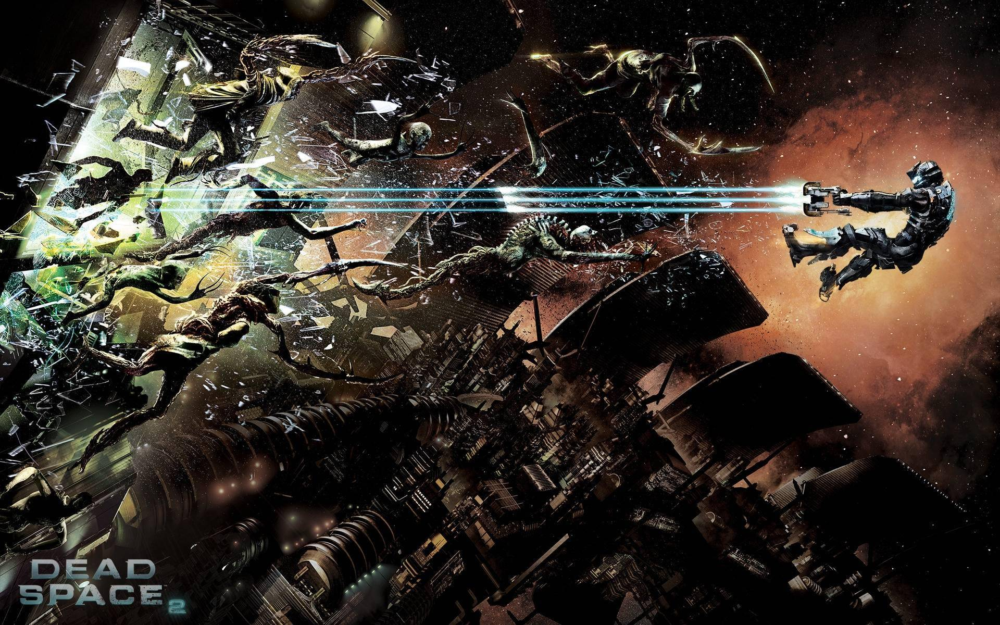

# Dead Space 2 Recomp

> **Prerelease playtest — expect bugs.** No game data is included. You need your own retail copy of Dead Space 2 to build and play.

A static recompilation of the Xbox 360 version of Dead Space 2 that runs natively on PC.
The whole game executable (47,739 functions, Title Update 2) is translated to C++ by
[ReXGlue](https://github.com/rexglue/rexglue-sdk) and laid out using the game's PDB:
original source folders, real function names, original file boundaries.

Dead Space 2 already has an official PC release; this project isn't a replacement for it.
It has two goals:
- **Portability:** turn the 360 version into plain C++ that can move to ARM devices (Switch and others).
- **PDB mapping:** test how far a prototype PDB can name and place recompiled code directly,
  with no decompilation step, with every name and source file backed by measured precision.

Mods are supported through a hook API keyed by those PDB names.

## Status
TU2 is now the only supported build; the tooling remains in `tools/`.
The campaign and Severed DLC have not been fully playtested.

- **TU2 names:** carried from base by proof. 45,912 are *proven* and 885 *probable*. The probable ones need an opt-in before a mod can hook them.
- **Disc 2:** with Title Update #2 it patches to an image byte-identical to Disc 1, so the TU2 build runs it too. The launcher supplies both discs for automatic switching; full campaign validation remains pending.
- **DLC, *Dead Space 2: Severed*:** working, but **not fully playtested**. The package installs with `tools/extract_dlc.py` and the game mounts it. Severed has been smoke-tested, not played through.
- **Multiplayer and Xbox Live features** (online play, leaderboards, achievements syncing, marketplace) are **not tested yet**.
- **Launcher:** included in the [playtest release](https://github.com/bifftannen1/Dead-Space-2-Recomp/releases/tag/tu2-playtest-20261017), with file verification, DLC setup, display options and language selection.
- **Languages:** English and French voices; Spanish text/subtitles with English voices on the supported World (En,Fr,Es) discs.
- **Feedback:** report bugs through [Issues](https://github.com/bifftannen1/Dead-Space-2-Recomp/issues), including your chapter/DLC, GPU and latest log. First-run shader compilation may cause stutter; restart and check whether it improves.

## Sources
| | |
|---|---|
| Retail Disc 1 | *Dead Space 2 (World) (En,Fr,Es)*, Disc 1 `default.xex`, Title ID `454108DF`, Media ID `2915C8F8` |
| Retail Disc 2 | Same release, Disc 2 `default.xex`, Media ID `403243EC` |
| Title Update | *Dead Space 2 Title Update #2* (`TU_12K226V_000000C000000.00000000000G3`); `disc001/default.xexp` sha256 `8d386d37…01ec2`, which patches the XEX to version `0.0.2.3` |
| DLC | *Dead Space 2: Severed* (content type `00000002`, package `1B7ECDF8…7E45`) |
| PDB | `deadspace_f.pdb`, 2010-11-19 prototype build |

The prototype is a near-exact match for retail: of 22,976 functions compared by compiled size,
22,962 (99.94%) are identical. The 14 that differ are all XDK runtime code (CRT file I/O, heap);
the game's own code matches throughout.

## Quick start
1. Download **DS2-TU2-Playtest-20261017-Setup.exe** (installer), or extract **DS2-TU2-Playtest-20261017.zip** (portable), from the [release](https://github.com/bifftannen1/Dead-Space-2-Recomp/releases/tag/tu2-playtest-20261017).
2. Run `DS2Launcher.exe`, select your own Disc 1 and Title Update 2, plus Disc 2 and Severed if available.
3. Verify files, choose your options and language, then launch.

Build from source: [docs/BUILDING.md](docs/BUILDING.md). No game data, title update or DLC is included.

## Layout
| Path | What |
|---|---|
| `src_tu2/` | Recompiled Title Update #2 game code; `src/app` and `src/modapi` are shared |
| `src_tu2/_units/` | 157 build units matching the codegen translation units |
| `src_tu2/symbols.tsv`, `src_tu2/ds2_names.h` | Address → PDB name map |
| `src/app/` | Host app (`ds2.exe`) |
| `src/modapi/`, `mods/` | Mod API and example mods |
| `sdk/` | Pinned ReXGlue commit and the DS2 patch |
| `tools/` | Build, XEX extraction, smoke test, object comparison, mod generators, `pdbchain` (PDB matching, including `V0_PREV_BUILD` for carrying names to a new build), `tu2/` (build-to-build tooling) |

## Docs
- [BUILDING.md](docs/BUILDING.md): build, run, smoke test
- [MODDING.md](docs/MODDING.md): hooks by PDB name, loose files, PDB struct headers
- [NAMED_TREE.md](docs/NAMED_TREE.md): how functions got their names and files
- [PDB_MATCHING.md](docs/PDB_MATCHING.md): matching tools, method and timeline
- [REGENERATING.md](docs/REGENERATING.md): refreshing `src/` from the pipeline repo
- [TODO.md](docs/TODO.md): roadmap (raw mouse, ultrawide, above 60 FPS, graphics options, multiplayer, disc swap)

## Credits
- **[ReXGlue](https://github.com/rexglue/rexglue-sdk)** and its developers: the Xbox 360 static recompilation toolkit and runtime this project is built on.
- **[Xenia](https://github.com/xenia-project/xenia)** and its developers ([xenia.jp](https://xenia.jp)): the Xbox 360 emulator whose kernel, GPU (Xenos) and file-system work ReXGlue's runtime builds on.
